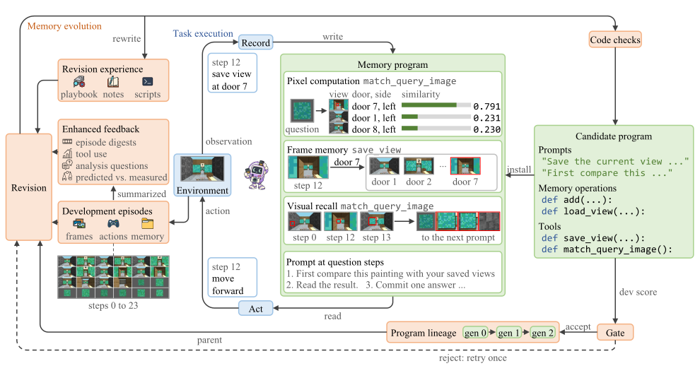

<p align="center">
  
</p>

<h1 align="center"></h1>

<p align="center"><strong>Recursively Self-Evolving Visual Agents for Exploration with Deferred Queries</strong></p>

<p align="center">
  <a href="https://evovim.github.io/">Project Website</a> ·
  <a href="#quickstart">Quickstart</a> ·
  <a href="#reproduce-a-benchmark">Benchmarks</a> ·
  <a href="EvoViM/programs/catalog.json">Programs</a> ·
  <a href="#how-it-works">Method</a>
</p>

**EvoViM evolves Python tools for visual memory.** An agent can save a painting it passes and later match a crop to the doorway where it saw it. Try one of 18 selected programs across three models and six benchmarks.

## Quickstart

**Python 3.10+ · macOS or Linux · No API key.** From the root of this repository, install EvoViM and play four cards with the evolved Card Matching program.

```sh
python3 -m venv .venv
. .venv/bin/activate
python -m pip install .
evovim demo --cards
```

**Expected result** — four flips, `"recalled_pair": ["bA", "aA"]` and `"score": 1.0`. The scripted player tries three cards. On the fourth turn it asks the released program for a match, recalls the saved image and plays the coordinate the program returned.

| Flip `aA` | Flip `aB` | Flip `bA` | Recall and flip `aA` |
| :---: | :---: | :---: | :---: |
|  |  |  |  |

These four observations come from a local run. The demo generates its own board and makes no network requests. To save your own, run `evovim demo --cards --output runs/cards` and open `final_observation.png`, `trajectory.jsonl` or `calls.jsonl` in that directory. Choose a fresh output directory for each run.

<details>
<summary>Use the tested Python 3.10 dependencies or run the offline tests</summary>

On Python 3.10, use `python -m pip install -c examples/constraints-py310.txt .` for the tested dependency versions. Run the offline tests from the repository root.

```sh
python -m unittest discover -s tests -v
```

The suite checks all released program hashes, visual retrieval, benchmark execution, candidate selection, held-out evaluation and interrupted-run recovery.

</details>

## Reproduce a benchmark

The original Card Matching task uses a **12 × 12 board with 72 pairs**. The following steps take you from the four-card demo to a held-out evaluation of the same memory program.

**1. Check the environment.** Install the pinned RNGBench assets and set `EVOVIM_RNGBENCH_ROOT` as described in the setup guide. Then exercise the original board and candidate for one step with a scripted reply. [RNGBench setup](examples/benchmarks.md#card-matching-and-poster-maze)

```sh
evovim evaluate gpt/card-matching --smoke --output runs/card-smoke
```

**2. Run one held-out episode.** Set `OPENAI_API_KEY` in your shell. Set `EVOVIM_EPISODE_MODEL` to the model ID your vision endpoint serves. The archived GPT run used GPT-6.1 Sol. This command calls the model for a full episode of up to 360 flips.

```sh
evovim evaluate gpt/card-matching --model "$EVOVIM_EPISODE_MODEL" \
    --seed 47 --output runs/card-47
```

Open `runs/card-47/summary.json`. Its `score` is the fraction of pairs cleared. The archived program cleared all 72 pairs on seed 47. A different model or service version can produce a different trajectory. [Per-seed reference scores](EvoViM/programs/catalog.json)

<details>
<summary><strong>Reproduce the five-seed Card Matching mean</strong></summary>

After seed 47 completes, run the other four held-out seeds with the same endpoint. Each command runs one full episode and writes its own trace.

```sh
for seed in 48 49 52 53; do
  evovim evaluate gpt/card-matching --model "$EVOVIM_EPISODE_MODEL" \
      --seed "$seed" --output "runs/card-$seed" || break
done
```

After all five commands have succeeded (including seed 47), compare your mean with the archived mean of `1.0`.

```python
import json
from pathlib import Path
from statistics import mean

seeds = [47, 48, 49, 52, 53]
scores = [json.loads(Path(f"runs/card-{s}/summary.json").read_text())["score"] for s in seeds]
print(mean(scores))
```

</details>

### Choose another program

Run `evovim programs` to list every `model/task` ID. Use `evovim export gpt/card-matching ./card-program` to write a standalone directory containing `candidate.py`, its imports and its original hash manifest.

| Program prefix | Model used in the archived run | Credential for a live evaluation |
| --- | --- | --- |
| `gpt/` | GPT-6.1 Sol | `OPENAI_API_KEY` |
| `haiku/` | Claude Haiku 5.5 | `ANTHROPIC_API_KEY` |
| `qwen/` | Qwen3.8-27B | `OPENAI_API_KEY` for a compatible deployment |

Each prefix has programs for `card-matching`, `dmv-hard`, `minecraft-gallery`, `poster-maze`, `tetris` and `pac-man`. Select a compatible service with `EVOVIM_EPISODE_BASE_URL`. GPT and Qwen use Chat Completions. Haiku uses Anthropic Messages. The task definitions give the episode horizon and the exact held-out seeds for each benchmark. [Environment setup](examples/benchmarks.md) · [Task definitions](EvoViM/benchmarks/tasks.json)

## How it works

During an episode, a frozen model uses a Python memory program to store observations, recall evidence and choose actions. Between generations, a revision model reads development traces and edits that program. An evaluation determines which version becomes the next parent.

[](docs/assets/framework.svg)

### Evolve your own program

The GridMemory example starts from the visual scaffold and runs one development seed for one generation. It uses an image-capable Chat Completions endpoint, a signed-in Codex CLI for revisions and macOS Seatbelt for worker isolation. Set `OPENAI_API_KEY` and `EVOVIM_EPISODE_MODEL` before starting the campaign.

```sh
export EVOVIM_META_WORKSPACE="$(mktemp -d /tmp/evovim-workspace.XXXXXX)"
evovim run --manifest examples/gridmemory.yaml --run-root runs/grid
evovim verify --run-root runs/grid
```

To resume, keep the same workspace and rerun the campaign command. To exercise the selected program on the offline grid, pass its directory to the demo. [GridMemory manifest](examples/gridmemory.yaml)

```sh
evovim demo --bundle \
    runs/grid/environments/gridmemory/lines/M/parent
```

<details>
<summary>Use a released program with your own environment or model</summary>

Supply an adapter for observations, actions and scoring, plus a model implementing `generate(call) -> ModelReply`. The standalone runner executes trusted program code in a subprocess. [Adapter interface](EvoViM/adapters/base.py) · [Working example](EvoViM/demo.py) · [Episode runner](EvoViM/host/episode.py)

```python
from EvoViM.host.episode import run_episode
from EvoViM.programs import open_program

with open_program("gpt/card-matching") as program:
    result = run_episode(adapter, program, line="M", seed=47, model=model, archive="runs/custom")
```

</details>
